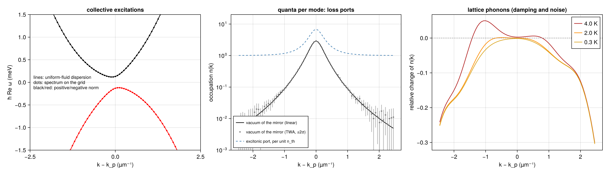
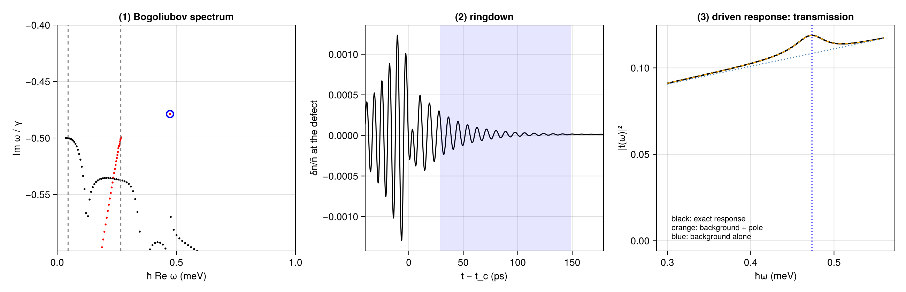
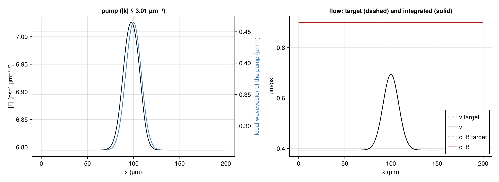
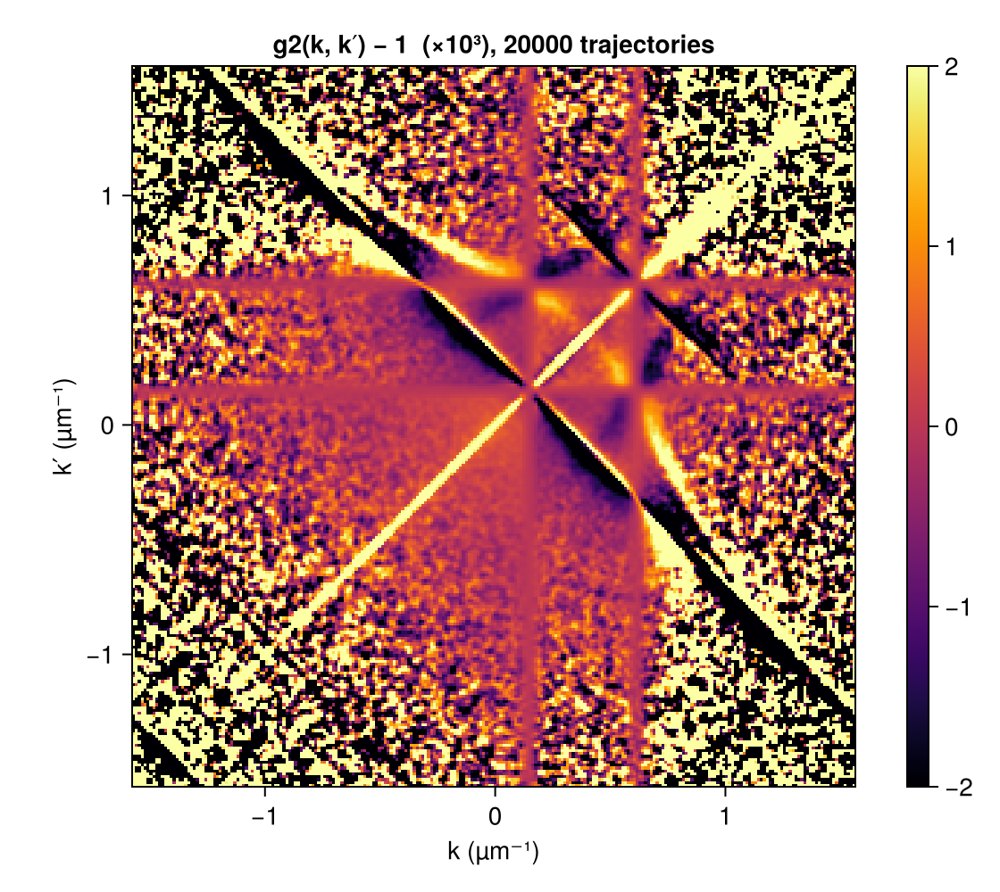

# PolaritonHorizons.jl

[](https://doi.org/10.5281/zenodo.24301905)

PolaritonHorizons.jl computes the statistics of the quantum noise of driven-dissipative bosonic fields in one
dimension. A coherent pump sustains a stationary field against losses; the losses let the noise of the environment in,
and the nonlinearity of the field mixes this noise into correlated excitations. The package computes the stationary
field, its collective excitations, the noise they carry with every input of the environment, and what a detector
records of it, and it checks the linear theory against stochastic simulations of the full nonlinear equation.

The implementation used to develop and test it is a fluid of exciton–polaritons in a semiconductor microcavity, with
the parameters of the GaAs sample of the Laboratoire Kastler Brossel [3–7]. The fluid is driven by a pump of
controlled amplitude and phase, so that its flow, and in particular acoustic horizons where it turns from subsonic to
supersonic, can be designed all-optically. The Hawking effect at such a horizon, the mixing of positive- and
negative-norm excitations by the stationary flow, is the main physical application [1, 2].

Units are µm, ps and meV; frequencies are in ps⁻¹, in the frame rotating at the pump frequency. Time integration uses
[GeneralizedGrossPitaevskii.jl](https://github.com/marcsgil/GeneralizedGrossPitaevskii.jl) (Strang splitting, batched
trajectories, CPU and GPU).

## What it computes

The field obeys the driven-dissipative Gross–Pitaevskii equation in the frame of the pump,

    i∂ₜψ = [e(−i∂ₓ) − δ₀ + V(x) + V_res(x) − iκ(x) + g(|ψ|² − 1/dx)] ψ + F(x) + √(κ(x)/dx) ξ(x, t),

with a parabolic or lower-polariton dispersion e(k), a potential V, a frozen exciton reservoir V_res, losses κ and a
pump F. The package treats it in three ways that share the same grid and operators.

- **Mean field.** Stationary states by time integration, or by design: any smooth target flow is an exact stationary
  state of the equation for one pump profile (`designed_setup`, `exact_pump`). Local description of each uniform
  region and its dispersion relation (`local_fluid`, `lda_omega`).
- **Linearised fluctuations.** The full Bogoliubov spectrum on the grid, including quasinormal modes
  (`bogoliubov_spectrum`, `find_qnm`), and the exact response to a weak probe at any frequency (`LinearResponse`).
  The quantum noise follows from one input port per loss channel: the vacuum of the cavity mirror, the non-radiative
  excitonic channel with its own occupation, and the lattice phonons of the semiconductor at the temperature of the
  cryostat [7]. The spectral and equal-time covariances of the fluctuations (`spectral_covariance`,
  `stationary_covariance`, `phonon_covariance`) give, through the input–output relation, the Gaussian state of any
  set of detected modes (`mode_state`), intensity-noise spectra (`self_homodyne`) and entanglement criteria
  (`log_negativity`, `pair_ratio`), with optimisation of the detected modes (`optimise_modes`).
- **Truncated Wigner.** Stochastic trajectories of the full nonlinear equation with online accumulation of the
  moments in position and momentum space (`twa_run!`), on CPU threads or a GPU (`cluster/`).

Stimulated scattering is also simulated in the time domain: probe runs with frequency-resolved readout
(`probe_scan`), mode-resolved scattering coefficients and norm fluxes, and ringdown of wavepackets (`ringdown`).

The equations, conventions and functions are described in [docs/methods.md](docs/methods.md).

## Systematics

| Check | Result |
|---|---|
| Designed flow, integrated in time from the target, pump band-limited to an imaging aperture of NA 0.4 | stationary to 3×10⁻¹⁴; flow within 3×10⁻⁵ of the target ([examples/inverse_design.jl](examples/inverse_design.jl)) |
| Quasinormal mode of the geometry of Ref. [1] from diagonalisation, wavepacket ringdown in the full equation, and a pole fit of the driven transmission | ħΩ = 0.4735, 0.4737, 0.4735 meV; Im ω/γ = −0.479, −0.474, −0.474 ([examples/qnm_three_ways.jl](examples/qnm_three_ways.jl)) |
| Linear noise theory against truncated Wigner (512 trajectories), uniform fluid, vacuum inputs | occupations agree within the statistical error at every wavevector, median deviation 0.5σ ([examples/uniform_fluid.jl](examples/uniform_fluid.jl)) |
| Momentum correlations of Ref. [2] from truncated-Wigner trajectories | the Hawking–partner lines of Fig. 2(c) of Ref. [2] appear at 2×10⁴ trajectories (9 min) ([examples/reproduce_momentum_correlations.jl](examples/reproduce_momentum_correlations.jl)) |
| Exact linear response against probe simulations of the full equation | agreement to 3×10⁻⁴; Bogoliubov norm balance closes to 0.2 % |
| Time step of the Strang splitting | dt = 0.01 ps changes probe readouts by ≤ 10⁻³ relative to dt = 0.005 ps |
| Single precision | not suitable for probe runs; usable for truncated Wigner after a comparison with double precision |
| Truncated Wigner and linear theory on the same flow | the Wigner noise adds g/dx to the interaction energy on average; the comparison runs the simulation with V lowered by g/dx ([docs/methods.md](docs/methods.md), §6.3) |

Run times on a laptop (Apple M4, 4 threads): stationary state of the geometry of Ref. [1] (N = 2048) about 40 s;
full Bogoliubov spectrum about 50 s; exact linear response 40 ms per frequency; a 294-frequency probe scan 21 min.

## Examples

Each example is a single script with its own figure, run from the repository root:

```bash
julia --project=examples -e 'using Pkg; Pkg.develop(path="."); Pkg.instantiate()'
julia -t 4 --project=examples examples/uniform_fluid.jl
```

- [uniform_fluid.jl](examples/uniform_fluid.jl): a homogeneous driven fluid. Its Bogoliubov spectrum on the grid
  against the dispersion of a uniform fluid, and the occupation of its fluctuations from each input: vacuum of the
  mirror, lattice phonons at 4 K, 2 K and 0.3 K, and the excitonic port per unit of its occupation. The vacuum part
  is compared with truncated-Wigner trajectories.
- [inverse_design.jl](examples/inverse_design.jl): a subsonic flow with a local acceleration, the pump that sustains it
  exactly, its stability, and the flow obtained by integrating the equation from the target.
- [qnm_three_ways.jl](examples/qnm_three_ways.jl): the quasinormal mode of the horizon of Ref. [1], from the spectrum,
  from the ringdown of a wavepacket in the full equation, and from a pole fit of the driven response.
- [reproduce_momentum_correlations.jl](examples/reproduce_momentum_correlations.jl): the momentum correlations of the
  light emitted by the horizon of Ref. [2], Fig. 2(c), from truncated-Wigner trajectories.






## Installation

```julia
using Pkg
Pkg.add(url="https://github.com/ximma/PolaritonHorizons.jl")
```

Julia 1.11 or later (GeneralizedGrossPitaevskii.jl is installed from its repository through `[sources]`). Tests: `julia --project -e 'using Pkg; Pkg.test()'` (about a minute).

## Citing

If you use this package, please cite the archived release, DOI [10.5281/zenodo.24301905](https://doi.org/10.5281/zenodo.24301905)
(see [CITATION.cff](CITATION.cff)), and the papers of the methods you use.

<!-- BEGIN CREDITS -->
## Contributors

- Maxime J. Jacquet (Laboratoire Kastler Brossel), author, [ORCID 0000-0003-0977-7054](https://orcid.org/0000-0003-0977-7054).
- Mattheus Burkhard and Malte Kroj wrote the simulations of Ref. [1], whose stimulated-scattering and ringdown
  protocols this package follows.
- Marcos Gil de Oliveira ([marcsgil](https://github.com/marcsgil), [ORCID 0009-0006-4225-8706](https://orcid.org/0009-0006-4225-8706))
  wrote GeneralizedGrossPitaevskii.jl and the truncated-Wigner protocol of Ref. [2].
<!-- END CREDITS -->

## References

1. M. Burkhard, M. Kroj, K. Falque, A. Bramati, I. Carusotto, and M. J. Jacquet, C. R. Phys. 25, 341 (2026), arXiv:2511.12339.
2. M. Gil de Olivera, M. Joly, A. Z. Khoury, A. Bramati, and M. J. Jacquet, Phys. Rev. A 114, L021701 (2026), arXiv:2512.17807.
3. F. Claude, M. J. Jacquet, R. Usciati, I. Carusotto, E. Giacobino, A. Bramati, and Q. Glorieux, Phys. Rev. Lett. 129, 103601 (2022).
4. F. Claude, M. J. Jacquet, I. Carusotto, Q. Glorieux, E. Giacobino, and A. Bramati, Phys. Rev. B 107, 174507 (2023).
5. K. Falque, A. Delhom, Q. Glorieux, E. Giacobino, A. Bramati, and M. J. Jacquet, Phys. Rev. Lett. 135, 023401 (2025).
6. K. Guerrero, K. Falque, E. Giacobino, A. Bramati, and M. J. Jacquet, Phys. Rev. Lett. 135, 243801 (2025).
7. I. Frérot, A. Vashisht, M. Morassi, A. Lemaître, S. Ravets, J. Bloch, A. Minguzzi, and M. Richard, Phys. Rev. X 13, 041058 (2023).

## Licence

MIT, see [LICENSE](LICENSE).
